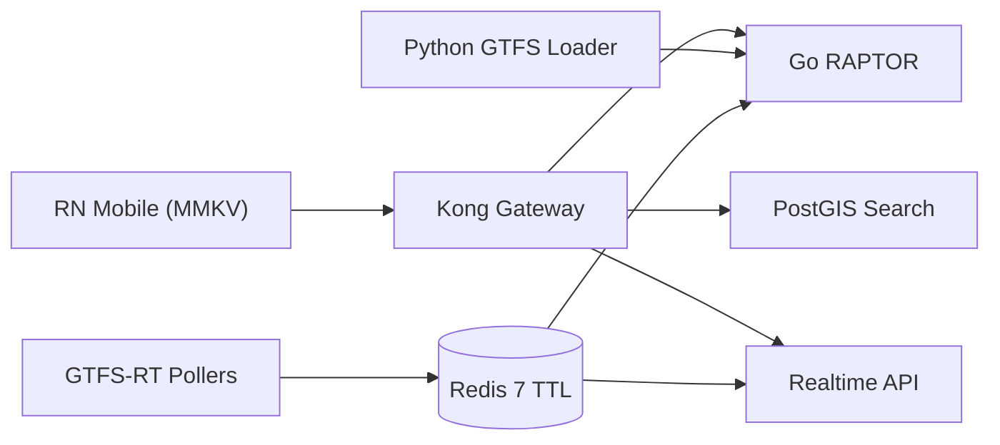

### System Architecture

City Connector splits static timetable routing from live vehicle telemetry so a flaky operator feed never slows down or breaks journey planning.



Every agency's identifiers are prefixed at ingestion time (`{agency_code}:{entity_id}`) and never merged. When one operator's live feed drops, the app flags only that operator with a `<FeedStatusBanner />` and falls back to its scheduled timetable while healthy feeds keep updating.

---

### How RAPTOR Keeps Routing Under 10ms

Most road-navigation apps use Dijkstra or A* over a weighted graph, which spends most of its time managing priority queues and expanding edges. Public transit doesn't need that—it runs on fixed routes and repeating timetables.

I implemented **RAPTOR** (Round-Based Public Transit Routing) in Go (`services/routing/`). Instead of walking a graph, RAPTOR scans contiguous in-memory arrays of routes and stops in rounds:

- **Round 0:** Find all stops reachable on foot from the origin.
- **Round k:** Scan only the routes passing through stops improved in round `k - 1`, recording the earliest arrival at each stop with at most `k` transfers.
- **Pareto pruning:** Discard any itinerary that is both slower and requires more transfers than an already-found path.

Because the timetable lives in flat slices rather than pointer-heavy graph structs, CPU cache locality stays high and multi-criteria queries (fastest, fewest transfers, least walking) finish in single-digit milliseconds. When the Python 3.12 ingestion worker parses a new static GTFS (General Transit Feed Specification) ZIP archive into PostgreSQL, the routing service loads the new snapshot in the background and swaps a single atomic pointer—zero downtime and zero read locks.

---

### Stopping Ghost Buses & Protecting the Gateway

Stale GPS coordinates destroy rider trust faster than no live data at all. Dedicated per-agency Go pollers read live GTFS-RT (Real-Time) protocol buffer feeds and write vehicle positions and trip delays into Redis 7 with short TTLs (`60–120s`). On the mobile client, any vehicle snapshot older than 30 seconds (`EXPO_PUBLIC_REALTIME_STALE_THRESHOLD_MS`) or missing from the latest poll is evicted immediately from the MapLibre vector map.

To keep mobile clients from overwhelming Kong Gateway quotas during rush hour, I put a proactive token-bucket rate limiter directly in the app before requests leave the device:

```ts
// Proactive client-side buckets mirror Kong Gateway route quotas
const ROUTE_BUCKETS = {
  journey: new TokenBucket({ capacity: 4, refillPerMinute: 4 }),
  nearby: new TokenBucket({ capacity: 15, refillPerMinute: 15 }),
  search: new TokenBucket({ capacity: 30, refillPerMinute: 30 }),
}
```

If the user still hits a gateway limit, a Ky HTTP interceptor reads the `429 Retry-After` header and renders a live countdown instead of an opaque error.

---

### Offline-First Mobile Sync & Contract Safety

Commuters lose reception in tunnels and basements right when they need to check their next transfer. I paired TanStack Query v5 with synchronous `react-native-mmkv` persistence for schedules and recent journeys, and Zustand v5 (also backed by MMKV) for user preferences and bilingual English/Swahili (`en`/`sw`) state.

Every response crossing the network boundary is parsed through a **Zod v4** schema before touching React state. If an upstream agency feed returns a malformed field, the error is isolated at the boundary instead of crashing the map screen. End-to-end flows are verified with Jest + MSW v2 mocks and Maestro mobile tests.
