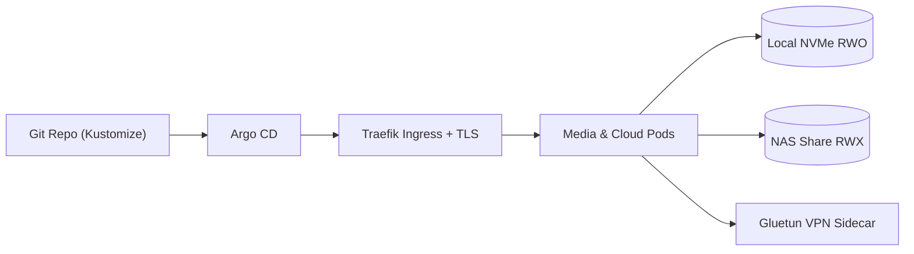

### Progressive 3-Level Migration Topology

Jumping straight from Docker Compose to full GitOps overwhelms most self-hosters. I structured the repository as three runnable stages so each layer solves one specific operational pain point:



- **Level 1 (Clean Primitives):** Breaks monolithic Compose files into isolated `Deployments`, `Services`, `ConfigMaps`, and `PersistentVolumeClaims` inside a dedicated `media-stack` namespace—eliminating the "one giant pod" anti-pattern.
- **Level 2 (Ingress & Kustomize):** Replaces port sprawl (`:8080`, `:8989`, `:7878`) with domain-based routing (`*.homelab.internal`) via Traefik/NGINX Ingress, adds HTTP liveness/readiness probes, and moves shared manifests into `base/` with per-environment `overlays/`.
- **Level 3 (GitOps & Hardening):** Hands reconciliation to **Argo CD**, automates Let's Encrypt certificates with **cert-manager**, enables Intel QuickSync / NVIDIA GPU passthrough for 4K transcoding, and locks down egress with VPN sidecars.

---

### Fail-Closed VPN Sidecar Networking

Running a download client (like qBittorrent) with an app-level proxy leaves a window for real-IP leaks whenever the VPN reconnects. Instead, I co-locate the downloader and a **Gluetun** VPN container inside the same Kubernetes Pod so they share a single Linux network namespace:

```yaml
# Both containers share one network namespace; all egress routes through tun0
containers:
  - name: gluetun
    image: qmcgaw/gluetun:latest
    securityContext:
      capabilities:
        add: ["NET_ADMIN"]
  - name: qbittorrent
    image: lscr.io/linuxserver/qbittorrent:latest
```

Because `gluetun` owns the pod's firewall rules and `tun0` interface, a dropped VPN tunnel immediately halts all egress traffic from `qbittorrent` until the tunnel recovers—zero unencrypted packets can escape.

---

### Respecting Storage Semantics (RWO vs. RWX)

The fastest way to corrupt self-hosted apps (*Sonarr, Radarr, Prowlarr, Jellyseerr, Bazarr*) on Kubernetes is mounting their SQLite config databases over NFS or SMB. Network filesystems struggle with SQLite file locking under concurrent writes.

I split storage into two explicit `StorageClass` tiers:
- **Local NVMe (`ReadWriteOnce`):** Holds all application configs and SQLite/PostgreSQL databases for low-latency, lock-safe writes.
- **Network NAS (`ReadWriteMany`):** Holds bulk media libraries so downloaders, indexers, and media servers (Emby/Plex) can read and write concurrently without blocking each other.
