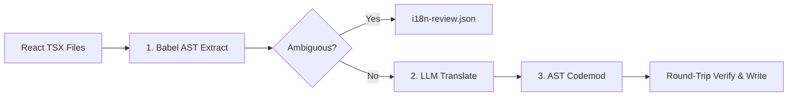

### The 3-Phase AST → LLM → AST Pipeline

The core rule behind `i18n-cli` is simple: **never let an LLM rewrite source code directly**. LLMs are great at translating natural language with context, while an Abstract Syntax Tree (AST) compiler is deterministic at editing JSX and TypeScript.



1. **Extract (`@babel/parser` + `@babel/traverse`):** Walks every TSX file and collects only user-visible JSX text, attributes (`aria-label`, `placeholder`, `title`), and template literals—ignoring object keys, imports, and type unions.
2. **Translate (Pluggable Providers):** Sends extracted strings with surrounding component context, sibling labels, and masked interpolation tokens (`{{count}}`) to Google Gemini, OpenAI, DeepL, or a local Ollama model.
3. **Rewrite (Deterministic Codemod):** Injects `useTranslation()`, replaces literals with `t('key')` calls, and preserves the repository's Prettier formatting.

---

### Solving the Dual-Use String Trap

In real React codebases, strings frequently pull double duty as both UI labels and internal logic comparisons:

```tsx
// "Dar es Salaam" is both a visible chip and a state filter key
const filtered = listings.filter((item) => item.city === selectedCity)
return <button onClick={() => setSelectedCity("Dar es Salaam")}>Dar es Salaam</button>
```

Translating the string inside `setSelectedCity(...)` silently breaks filtering in every non-English locale. Whenever the AST analyzer detects a literal used in a state setter, equality check, or object lookup, it refuses to guess and routes that entry to `i18n-review.json` for a quick human confirmation.

---

### Verification Gates & Atomic Rollbacks

Before any file is modified on disk, `i18n-cli` runs two checks:
- **AST round-trip verification:** Re-parses every generated file with Babel to guarantee zero syntax regressions or dropped interpolation variables.
- **Pseudo-localization mode:** Replaces strings with accented, expanded text (`[~Hëllö Wörld~]`) so teams can spot layout clipping and hardcoded concatenations before spending money on LLM translation tokens.

All transformed files are written into a temporary staging buffer first. If the developer hits `Ctrl+C` (`SIGINT`) or a provider call fails mid-run (`SIGTERM`), the signal handler restores every original file atomically so the working tree is never left half-migrated.
