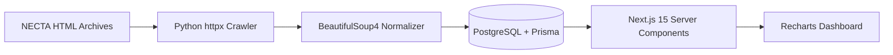

### Data Ingestion & Serving Pipeline

I decoupled data collection from the web app so I could re-crawl a single exam year or patch a legacy HTML parser without ever touching or taking down the dashboard.



---

### Crawling Inconsistent Government HTML Without Headless Browsers

NECTA's result pages are plain static HTML—no client-side JavaScript rendering required—so spinning up Playwright or Puppeteer would have wasted memory and CPU. Instead, I built a Python CLI (`crawler/`) using async `httpx` and `BeautifulSoup4` that walks the three-tier hierarchy (`exam year → regions/centres → candidate grade tables`) concurrently with rate-limit backoffs and automatic retries:

```bash
necta-crawler start --exam csee --year 2025
```

Targeted flags let me ingest or re-sync a single exam level (`SFNA`, `PSLE`, `FTNA`, `CSEE`, or `ACSEE`) and year on demand. Because historical templates drift—columns shift, headers change capitalization, or summary tables are missing—every parser normalizes rows defensively and writes via idempotent upserts so re-running a failed crawl never creates duplicate candidate records.

---

### Schema Indexing & Zero-Waterfall Analytics

Storing raw JSON blobs per school would have made multi-year regional rankings painfully slow. I modeled exam levels, regions, school centres, and candidate grade distributions as normalized PostgreSQL tables managed with Prisma ORM, adding composite indexes on `(examLevel, year, regionCode)` and `(schoolCode, year)`.

On the frontend (`web/`), Next.js 15 React Server Components execute those ranking and pass-rate aggregations directly against PostgreSQL on the server before streaming HTML to the browser. Only the interactive Recharts visualizations hydrate on the client, which keeps JavaScript bundles small and page loads snappy on mobile connections across Tanzania.
