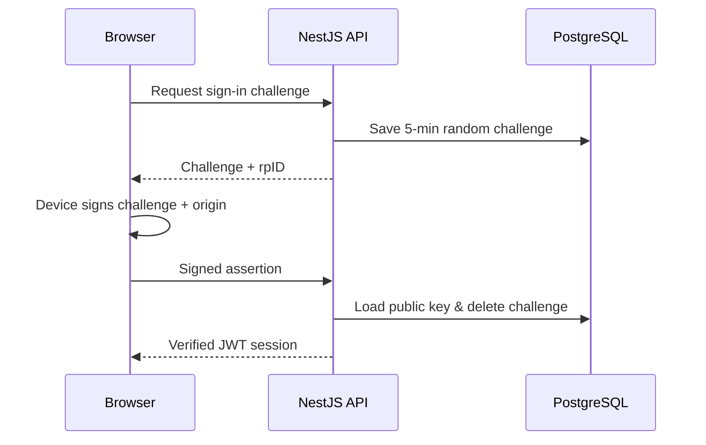

### Authentication Ceremony Flow

WebAuthn (Web Authentication, part of the FIDO2 standard) replaces shared secrets with asymmetric key pairs locked inside the user's device. The private key never leaves TouchID, FaceID, Windows Hello, or a hardware security key; my PostgreSQL database only ever sees the public key.



Because the browser itself embeds the active page's origin into the signed payload, a phishing site running on `evil-login.com` cannot replay the signature against the real Relying Party ID (`rpID`). The NestJS backend rejects the origin mismatch immediately.

---

### Key Implementation Details

#### 1. Replay-Proof Challenges & Timezone Hygiene
To support user-nameless login (where a user taps a passkey before typing an email), I store active cryptographic challenges in a dedicated table with a 5-minute TTL rather than coupling them to a user row. One production trap I hit early: using plain `timestamp` columns in PostgreSQL caused challenges to expire prematurely whenever the app server and database ran in different timezones. Switching to `timestamptz` and deleting each challenge immediately on verification eliminated both clock-drift lockouts and replay windows.

#### 2. Compact Public-Key Storage (`isoBase64URL`)
Browser WebAuthn APIs return binary `Uint8Array` public keys, while JSON APIs and relational tables prefer strings. I serialize each public key using `@simplewebauthn/server`'s `isoBase64URL` helper before storing it in `passkey_credentials`, then decode it back to bytes during verification:

```ts
const verification = await verifyAuthenticationResponse({
  response: assertionPayload,
  expectedChallenge: storedChallenge.value,
  expectedOrigin: this.config.origin,
  expectedRPID: this.config.rpID,
  credential: {
    id: cred.credentialId,
    publicKey: isoBase64URL.toBuffer(cred.publicKey),
    counter: cred.counter,
  },
})
```

Passing `expectedOrigin` and `expectedRPID` explicitly here is what enforces phishing resistance—any proxied domain fails cryptographic verification before a session token is ever minted.

#### 3. Handling Synced Passkeys vs. Hardware Keys
Hardware security keys increment a monotonic signature counter on every sign-in, which lets the backend detect cloned tokens if a counter ever goes backward. Cloud-synced passkeys (like iCloud Keychain or Google Password Manager) often return `0` across devices instead of incrementing.

To avoid locking out legitimate Apple/Android users while still catching cloned hardware tokens, the verifier enforces strict counter increments only when both the stored counter and incoming counter are non-zero. During registration, I also pass `excludeCredentials` containing the user's existing credential IDs so the browser prevents enrolling the same device twice.
