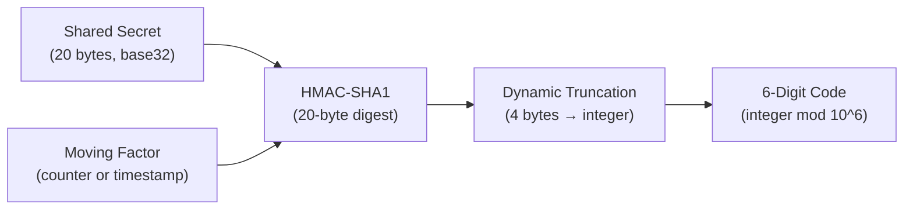
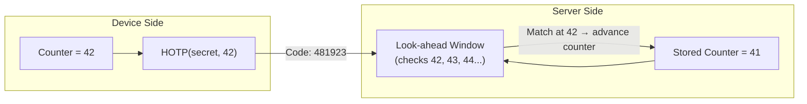
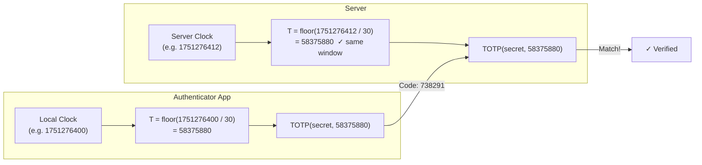
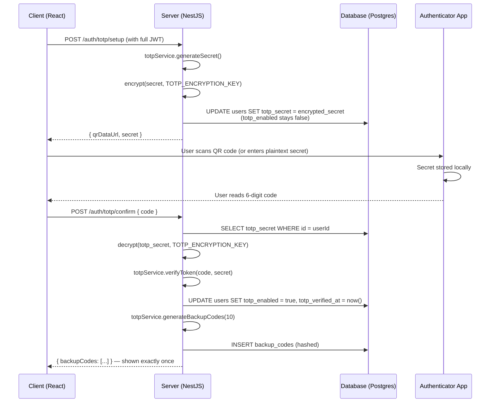

Put your phone in airplane mode, open Google Authenticator, and it still spits out the exact 6-digit code your server expects. No network call, no SMS, no sync—just math and a shared clock.

That’s the magic of **TOTP authentication** (RFC 6238). It’s simple on the surface, which is why most tutorials stop right after `totp.verify()`—leaving behind a 90-second replay window, plaintext secrets in the database, and half-baked JWT flows.

In this guide, you’ll learn how OTP, HOTP, and TOTP work from first principles, then walk through a production **NestJS + Drizzle ORM + React** implementation that handles encryption at rest, replay prevention, unbiased backup codes, rate limiting, and isolated JWT states.

## 1. How TOTP Works Offline (OTP → HOTP → TOTP)

Every OTP scheme—whether it’s a hardware key fob or an authenticator app—runs the same four-step pipeline:

1. **A shared secret:** A random 20-byte value (encoded as base32) generated once at setup and never sent again.
2. **A moving factor:** An input that changes so the same secret never produces the same code twice.
3. **HMAC-SHA1:** Combines the shared secret and moving factor into a 20-byte digest.
4. **Dynamic truncation:** Extracts a 4-byte slice from the digest and takes it modulo 10⁶ to produce a 6-digit code.



Because the pipeline is deterministic, **nothing is synced at login time.** Both your phone and the server run the same math on the same secret and arrive at the same 6-digit number independently.

### HOTP: Counter-Based (RFC 4226)

HOTP uses an **incrementing counter** as the moving factor—common in push-button hardware tokens like RSA SecurID.

The catch is **counter drift**: if a user clicks the button five times without logging in, the token gets ahead of the server. Servers handle this with a **look-ahead window**, checking the next *N* counter values and advancing their stored counter on match. Because the server only accepts counters strictly *greater* than the last match, replay prevention is built in.



### TOTP: Time-Based (RFC 6238)

TOTP swaps the counter for a **30-second time step** derived from Unix time:

```text
T = floor(current_unix_timestamp / 30)
```

As long as the phone and server clocks roughly agree, they compute the exact same `T` and the exact same 6-digit code. Servers typically tolerate **±1 time step (±30 seconds)** to account for clock skew and users typing a code right as it rolls over.



### OTP vs. HOTP vs. TOTP at a Glance

| Aspect | OTP (general) | HOTP | TOTP |
|---|---|---|---|
| **Moving factor** | Any changing input | Incrementing counter | `floor(unix_time / 30)` |
| **Needs clock sync** | — | No | Yes (rough, ±seconds) |
| **Resync after drift** | — | Yes (look-ahead window) | No (each window is independent) |
| **Code lifetime** | — | Until next code is generated | ~30 seconds |
| **Common use case** | — | Hardware tokens, push buttons | Authenticator apps (Google, Authy, 1Password) |
| **Network call to verify** | — | No | No |
| **Replay vulnerability** | — | No (counter advances on match) | **Yes within the window — must track used codes** |
| **This repo's tolerance** | — | N/A | ±1 step (±30 s), via `otplib` default |

**The row most apps get wrong is replay vulnerability.** TOTP expiry is *time-based*, not *use-based*—so without explicit tracking, the same code can be accepted twice within a 90-second span (previous + current + next window).

## 2. The Two Flows That Matter: Setup and Two-Step Login

Before writing code, map out the exact state transitions. You can follow along with the full source in [nelsonfrank/mfa on GitHub](https://github.com/nelsonfrank/mfa).

### The Setup Flow

During setup, the server generates a secret, **encrypts it before writing to Postgres**, and delivers it via an `otpauth://` QR code. Notice that `totp_enabled` stays `false` until the user proves they can generate a valid code—and backup codes are shown in plaintext **exactly once**.



### The Two-Step Login Flow

Once TOTP is enabled, password verification no longer returns a full session. Instead, step one issues a short-lived **5-minute `pendingToken`** that can *only* call the TOTP or backup-code endpoints.

```mermaid
sequenceDiagram
    participant C as Client (React)
    participant S as Server (NestJS)
    participant DB as Database (Postgres)

    C->>S: POST /auth/login { email, password }
    S->>DB: SELECT user WHERE email = ?
    S->>S: bcrypt.compare(password, passwordHash)
    alt MFA not enabled
        S-->>C: { access_token, user }
    else MFA enabled
        S->>S: jwtService.signAsync({ sub: userId, mfaPending: true }, { expiresIn: "5m" })
        S-->>C: { mfaPending: true, pendingToken }
        C->>C: Store pendingToken in component state (not localStorage)
        C->>S: POST /auth/login/totp { code }<br/>Authorization: Bearer &lt;pendingToken&gt;
        S->>S: PendingMfaGuard: verify token has mfaPending === true
        S->>DB: SELECT used_totp_codes WHERE userId = ? AND code = ?
        alt Code already used
            S-->>C: 401 "This verification code has already been used"
        else Code not used
            S->>DB: SELECT totp_secret WHERE userId = ?
            S->>S: decrypt(totp_secret, TOTP_ENCRYPTION_KEY)
            S->>S: totpService.verifyToken(code, secret)
            S->>DB: INSERT used_totp_codes { userId, code }
            S->>S: jwtService.signAsync({ sub: userId, email })
            S-->>C: { access_token, user }
            C->>C: localStorage.setItem("access_token", ...)
        end
    end
```

Keep `pendingToken` in **React component state—not `localStorage`**. It’s a transient 5-minute handoff token and shouldn’t persist across tabs or refreshes.

## 3. Secrets, Encryption at Rest, QR Delivery, and Verification

### Generating Secrets With Zero Native Dependencies

`TotpService` wraps `otplib` v13 using `NobleCryptoPlugin` (`@noble/hashes`) and `ScureBase32Plugin` (`@scure/base`)—audited, pure-TypeScript implementations that produce standard 20-byte base32 secrets compatible with any RFC 6238 app.

```typescript
// backend/src/auth/totp.service.ts
import { TOTP, NobleCryptoPlugin, ScureBase32Plugin } from 'otplib';

constructor() {
  this.totp = new TOTP({
    crypto: new NobleCryptoPlugin(),   // @noble/hashes for HMAC
    base32: new ScureBase32Plugin(),   // @scure/base for base32 encoding
  });
}

generateSecret(): string {
  return this.totp.generateSecret(); // 20-byte random → base32
}
```

### Encrypting Secrets at Rest (AES-256-CBC)

Unlike passwords, TOTP secrets are long-lived and must be readable by the server at login—meaning you can’t hash them. If an attacker gets read access to your database (via SQL injection or a leaked backup), plaintext secrets compromise every user’s second factor instantly.

Encrypting with **AES-256-CBC** and a fresh 16-byte IV per write ensures a DB read alone isn’t enough; the attacker also needs `TOTP_ENCRYPTION_KEY` from your environment.

```typescript
// backend/src/common/utils/encrypt.ts
export function encrypt(text: string, keyHex: string): string {
  const key = Buffer.from(keyHex, 'hex');     // 32-byte key from hex string
  const iv = crypto.randomBytes(16);           // fresh IV for every encryption
  const cipher = crypto.createCipheriv('aes-256-cbc', key, iv);

  let encrypted = cipher.update(text, 'utf8', 'hex');
  encrypted += cipher.final('hex');

  return `${iv.toString('hex')}:${encrypted}`; // stored as "iv:ciphertext"
}
```

In `AuthService`, the plaintext secret is encrypted immediately before saving—and decrypted only inline in a local variable during verification:

```typescript
// backend/src/auth/auth.service.ts — inside setupTotp()
const secret = this.totpService.generateSecret();
const key = this.configService.get<string>('TOTP_ENCRYPTION_KEY', '');
const encryptedSecret = encrypt(secret, key);

await this.db
  .update(schema.users)
  .set({ totpSecret: encryptedSecret })
  .where(eq(schema.users.id, userId));
```

### QR Code Delivery & Token Verification

Render the `otpauth://` URI straight to a base64 PNG data URL using `qrcode`—no files written to disk, no crawlable image URLs—and return the plaintext secret alongside it as a manual-entry fallback:

```typescript
// backend/src/auth/totp.service.ts
async generateQrDataUrl(email: string, secret: string): Promise<string> {
  const otpauthUrl = this.totp.toURI({
    label: email,
    issuer: this.appName, // 'SECURE_AUTH'
    secret,
  });
  return qrcode.toDataURL(otpauthUrl); // base64 PNG data URL
}

async verifyToken(token: string, secret: string): Promise<boolean> {
  try {
    const result = await this.totp.verify(token, { secret });
    return !!result.valid;
  } catch {
    return false;
  }
}
```

`otplib` defaults to **±1 step (±30 seconds)**—the RFC 6238 sweet spot. Tightening it to ±0 breaks users with slight clock drift; widening it adds exposure without helping usability.

## 4. Closing the 3 Gaps Most Tutorials Skip

### Gap 1: Replay Prevention (`used_totp_codes` + 90s Cleanup)

With ±1 step tolerance, a valid code can live for up to **90 seconds**. Without tracking used codes, an attacker who glimpses a code (shoulder-surfing, keylogger, or intercepted request) can replay it immediately.

Check a `used_totp_codes` table (indexed on `(userId, code)`) *before* verifying, and record every accepted code:

```typescript
// backend/src/auth/auth.service.ts — inside loginStep2()

// 1. Check before verifying
const recentCodes = await this.db
  .select()
  .from(schema.usedTotpCodes)
  .where(
    and(
      eq(schema.usedTotpCodes.userId, userId),
      eq(schema.usedTotpCodes.code, totpCode),
    ),
  )
  .limit(1);

if (recentCodes.length > 0) {
  throw new UnauthorizedException('This verification code has already been used');
}

// 2. Verify, then record
const isValid = await this.totpService.verifyToken(totpCode, secret);
if (!isValid) { throw new UnauthorizedException('Invalid verification code'); }

await this.db.insert(schema.usedTotpCodes).values({ userId, code: totpCode });
```

Then prune expired rows every minute with a 90-second cutoff (anything older than 90 seconds is guaranteed expired even with ±1 tolerance):

```typescript
// backend/src/auth/auth.service.ts
@Cron(CronExpression.EVERY_MINUTE)
async cleanUsedTotpCodes() {
  const ninetySecondsAgo = new Date(Date.now() - 90 * 1000);
  await this.db
    .delete(schema.usedTotpCodes)
    .where(lt(schema.usedTotpCodes.usedAt, ninetySecondsAgo));
}
```

### Gap 2: Unbiased, Bcrypt-Hashed Backup Codes

When users lose their phone, backup codes are their lifeline—which also makes them high-value credentials.

Two details matter here:
1. **Avoid modulo bias when generating codes:** With a 62-character alphabet, `byte % 62` favors the first 8 characters because 256 isn’t divisible by 62 (~0.8% bias per character). Discarding bytes ≥ 248 (rejection sampling) makes the distribution uniform.
2. **Store only bcrypt hashes:** Treat backup codes like passwords. Show them once on `confirmTotp`, hash them with bcrypt, and mark each `used = true` on match (at most 10 rows per user, so a linear `bcrypt.compare` scan is fast).

```typescript
// backend/src/auth/totp.service.ts
generateBackupCodes(count = 10): string[] {
  const chars = 'ABCDEFGHIJKLMNOPQRSTUVWXYZabcdefghijklmnopqrstuvwxyz0123456789';
  const charsLen = chars.length;                 // 62
  const maxUnbiased = 256 - (256 % charsLen);    // 248 = largest multiple of 62 ≤ 256

  const codes: string[] = [];
  for (let i = 0; i < count; i++) {
    let code = '';
    while (code.length < 8) {
      const byte = randomBytes(1)[0];
      if (byte < maxUnbiased) {
        code += chars[byte % charsLen];
      }
      // Bytes in [248, 255] are discarded — no bias.
    }
    codes.push(code);
  }
  return codes;
}
```

```typescript
// backend/src/auth/auth.service.ts — inside confirmTotp()
const backupCodesToInsert = plainBackupCodes.map((code) => {
  const salt = bcrypt.genSaltSync(10);
  const codeHash = bcrypt.hashSync(code, salt);
  return { userId, codeHash, used: false };
});
await this.db.insert(schema.backupCodes).values(backupCodesToInsert);
```

### Gap 3: Tight Rate Limiting on Verification Endpoints

A 6-digit code has only 10⁶ combinations. Without rate limiting, an attacker with a valid `pendingToken` can hammer the verification endpoint. Apply per-IP throttling with `@nestjs/throttler`:

| Endpoint | Limit | Window |
|---|---|---|
| `POST /auth/login/totp` | 5 attempts | 15 minutes |
| `POST /auth/totp/backup` | 5 attempts | 15 minutes |
| `POST /auth/totp/confirm` | 10 attempts | 1 hour |

```typescript
// backend/src/auth/auth.controller.ts
@Post('login/totp')
@UseGuards(PendingMfaGuard, ThrottlerGuard)
@Throttle({ loginTotp: { limit: 5, ttl: 900000 } })
async loginTotp(@Req() req: Request, @Body() verifyTotpDto: VerifyTotpDto) { ... }
```

## 5. Isolating Login Steps With Two Mutually Exclusive JWT States

One subtle bug in two-step auth is accidentally letting a `pendingToken` access normal API routes—or letting a normal access token hit MFA setup/login endpoints in the wrong state.

Both tokens share the same JWT secret, separated by a single `mfaPending` flag and enforced by **mutually exclusive guards**:

| Token type | `mfaPending` field | Can access |
|---|---|---|
| Full access token | absent | All routes protected by `JwtAuthGuard` |
| Pending MFA token | `true`, expires in 5 min | Only `POST /auth/login/totp` and `POST /auth/totp/backup` |

```typescript
// backend/src/auth/guards/jwt-auth.guard.ts
const payload = await this.jwtService.verifyAsync<Record<string, unknown>>(token);
if (payload.mfaPending === true) {
  throw new UnauthorizedException('Multi-factor authentication required');
}
```

```typescript
// backend/src/auth/guards/pending-mfa.guard.ts
const payload = await this.jwtService.verifyAsync<Record<string, unknown>>(token);
if (payload.mfaPending !== true) {
  throw new UnauthorizedException('MFA is not pending or token is fully authorized');
}
```

Because the guards are exact inverses, it’s impossible to cross the two auth states by accident.

## 6. Production Tradeoffs to Plan For Before You Scale

This setup handles single-instance production cleanly—encrypted secrets, replay protection, unbiased hashed backup codes, rate limiting, and isolated JWTs. Before you scale it further, plan for these five realities:

- **Horizontal scaling & cron duplication:** `cleanUsedTotpCodes` runs on every NestJS instance. The deletes are idempotent, so it won’t break—but add a distributed lock or dedicated worker once you run multiple replicas.
- **Encryption key rotation:** `TOTP_ENCRYPTION_KEY` currently has no versioning. If you ever need to rotate it without forcing every user to re-enroll, store a key version prefix alongside `iv:ciphertext` and fall back to older keys during decryption.
- **Backup code exhaustion:** Surface the remaining unused backup code count in your security UI and prompt users to regenerate before they hit zero.
- **Account recovery policy:** There is deliberately no "I lost both my phone and my backup codes" bypass here—recovery flows are a top social-engineering target. Decide your support verification policy explicitly before launch.
- **Extreme client clock skew:** NTP handles 99% of devices, but a phone with a manual clock offset greater than ~1 minute will fail every TOTP check. Tell users clearly to re-enable automatic time sync (or use a backup code).

### Implementation Reference

Explore the full source in [nelsonfrank/mfa](https://github.com/nelsonfrank/mfa):

| File | Purpose |
|---|---|
| [backend/src/auth/totp.service.ts](https://github.com/nelsonfrank/mfa/blob/main/backend/src/auth/totp.service.ts) | Secret generation, QR code creation, token verification, backup code generation |
| [backend/src/auth/auth.service.ts](https://github.com/nelsonfrank/mfa/blob/main/backend/src/auth/auth.service.ts) | Setup, confirm, login step 2, disable, backup code verification, cron cleanup |
| [backend/src/auth/auth.controller.ts](https://github.com/nelsonfrank/mfa/blob/main/backend/src/auth/auth.controller.ts) | HTTP endpoints, guard wiring, and throttler annotations |
| [backend/src/auth/guards/jwt-auth.guard.ts](https://github.com/nelsonfrank/mfa/blob/main/backend/src/auth/guards/jwt-auth.guard.ts) | Rejects pending-MFA tokens from fully authenticated routes |
| [backend/src/auth/guards/pending-mfa.guard.ts](https://github.com/nelsonfrank/mfa/blob/main/backend/src/auth/guards/pending-mfa.guard.ts) | Accepts only pending-MFA tokens on TOTP verification routes |
| [backend/src/common/utils/encrypt.ts](https://github.com/nelsonfrank/mfa/blob/main/backend/src/common/utils/encrypt.ts) | AES-256-CBC encrypt/decrypt utilities |
| [backend/src/database/schema.ts](https://github.com/nelsonfrank/mfa/blob/main/backend/src/database/schema.ts) | `users`, `used_totp_codes`, and `backup_codes` tables (Drizzle ORM) |
| [backend/src/auth/auth.module.ts](https://github.com/nelsonfrank/mfa/blob/main/backend/src/auth/auth.module.ts) | NestJS module configuration, JWT settings, throttler profiles |
| [backend/src/auth/dto/totp.dto.ts](https://github.com/nelsonfrank/mfa/blob/main/backend/src/auth/dto/totp.dto.ts) | Input validation — 6-digit numeric TOTP codes, 8-character backup codes |
| [client/src/routes/security.tsx](https://github.com/nelsonfrank/mfa/blob/main/client/src/routes/security.tsx) | TOTP setup UI: QR display, manual secret, confirmation, backup code reveal |
| [client/src/routes/login.tsx](https://github.com/nelsonfrank/mfa/blob/main/client/src/routes/login.tsx) | Two-step login UI: credentials → TOTP challenge → backup code fallback |
| [client/src/lib/api.ts](https://github.com/nelsonfrank/mfa/blob/main/client/src/lib/api.ts) | Client-side API functions for all TOTP endpoints |

**Key dependencies:** `otplib` (`^13.4.1`), `qrcode` (`^1.5.4`), `bcryptjs` (`^3.0.3`), `@nestjs/throttler` (`^6.5.0`), `@nestjs/jwt` (`^11.0.2`), `drizzle-orm` (`^0.45.2`).

## The Key Takeaway

The math behind **TOTP authentication** is only 10% of the job. The other 90% is everything around it: **encrypting secrets at rest, closing the 90-second replay window, hashing unbiased backup codes, throttling guesses, and keeping pending JWTs locked out of protected routes.**

Clone the [nelsonfrank/mfa repository](https://github.com/nelsonfrank/mfa) to run the full NestJS + React flow locally, or use the checklist above to audit your existing MFA implementation.

**When you last built or audited TOTP in production, which of these 5 details—replay tracking, secret encryption, backup codes, rate limiting, or JWT isolation—was missing?** Share it with a teammate or drop a note!
